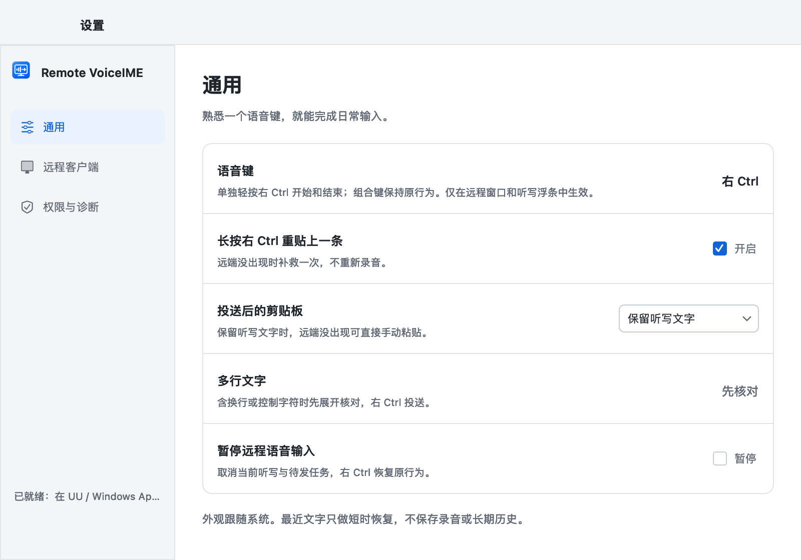

# Remote VoiceIME · 远程语音输入

**在本机说话，把文字送到远程电脑。**

远程桌面里也能用本机的豆包语音输入：在远端放好光标，按右 Ctrl 听写，结束后文字自动整段粘贴到原来的输入框。适合远程写文档、回复消息和填写表单。

Remote VoiceIME 安装在**你正在操作键盘和麦克风的本地电脑**，远端无需安装本工具。豆包输入法负责语音识别，远控软件负责连接和剪贴板同步。

`本机麦克风 → 本机豆包输入法 → Remote VoiceIME → 远控剪贴板同步 → 远端输入框`

## 下载

按**本地电脑**的系统选择，和远端是什么系统无关：

| 本地电脑 | 当前版本与下载 | 可用的远控软件 |
| --- | --- | --- |
| macOS · Apple Silicon（M 系列） | [0.3.0 alpha · 构建 10](https://github.com/jacksonlin-infra/remote-voiceime/releases/tag/v0.3.0-macos) · 下载 macOS arm64 ZIP | UU 远程、微软 Windows App |
| Windows · x64 | [0.3.1 alpha · 构建 11](https://github.com/jacksonlin-infra/remote-voiceime/releases/tag/v0.3.1-windows) · 推荐下载 `RemoteVoiceIME-0.3.1-win-x64-setup.exe`，另有免安装 ZIP | UU 远程、远程桌面连接（mstsc） |

macOS 要求 13+，当前发行包仅支持 Apple Silicon；Windows 目标为 10 / 11 x64，已内置 .NET 运行时，使用者无需安装开发工具。

**验证状态：** macOS、Windows 两端在 UU 远程、Windows App、mstsc 中的日常使用流程已经实际验证，基本功能稳定。发行版本仍标为 alpha；全屏、多显示器、其他输入法或客户端版本等专项范围见[支持范围与已知限制](docs/支持范围与已知限制.md)。

## 第一次使用

### 1. 先准备好豆包和远程连接

- 在**本机**安装、启用豆包输入法，先在本地文本编辑器中确认语音输入正常。
- 用上表对应的远控软件连上远端，开启**本地 → 远端剪贴板同步**。mstsc 在连接前进入“显示选项 → 本地资源”，勾选“剪贴板”；Windows App 在连接的“设备与音频 / Devices & Audio”设置中检查剪贴板选项；UU 在远控设置中开启剪贴板同步。
- 先在本地复制一小段文字，确认能在远端的空白文档中手动粘贴。手动粘贴不通时，先检查远控软件的同步设置。

只需本机能够使用麦克风和豆包，远端无需配置麦克风或安装豆包。

### 2. 安装并完成准备清单

| macOS | Windows |
| --- | --- |
| 退出旧版，将解压后的 `Remote VoiceIME.app` 放到“应用程序”再打开。按清单授予**辅助功能、输入监控**；授权后按提示重新打开应用。 | 退出托盘中的旧版，再运行安装程序。仅为当前用户安装，无需管理员权限；安装后从开始菜单打开。免安装版解压后运行 `Remote VoiceIME.exe`。 |
| 豆包自身的语音快捷键无需修改。 | **先在豆包中把语音键设为右 Ctrl、免按模式**；再在准备清单点“改用右 Ctrl”（同时开启自动投送），勾选已完成豆包设置。 |
| 确认已开启远控剪贴板同步，点“开始使用”。 | 确认已开启远控剪贴板同步，点“开始使用”。新安装初始是 F8＋核对后投送，需完成上一步才是下文的推荐流程。 |

应用准备好后驻留在 Mac 菜单栏或 Windows 系统托盘，没有常驻主窗口；从图标菜单打开设置、最近文字或退出。

| macOS 准备清单 | Windows 准备清单（右 Ctrl 模式） |
| --- | --- |
|  |  |

当前 macOS 使用临时签名，尚未公证；Windows 尚无发布者签名，首次打开可能出现系统安全提示。下载来源与处理方法见 [macOS 安装说明](docs/使用与排查.md#安装与升级)和 [Windows 安装说明](docs/Windows试用指南.md#安装)。

### 3. 试一次，确认这条连接能收到文字

1. 在准备清单或“设置 → 远程客户端”点击**试一次**，这一步不录音。
2. 切到远端的空白文档，放好光标，轻按右 Ctrl（若 Windows 仍用 F8，则按 F8）。
3. 确认测试文字完整出现一次，再在提示中选择“出现了”。没出现时，按提示调整粘贴键或同步速度后重试。

Windows 通过 UU 连接 Mac 时通常用 **Win＋V**，连接 Windows 时通常用 **Ctrl＋V**；mstsc 固定 Ctrl＋V。Mac 本地可选 ⌘V / Ctrl＋V，以你在该连接中手动粘贴能成功的按键为准。Windows 按 UU 设备记住配置，Mac 按远控客户端记住。

## 每天怎么用

**先点击远端输入框，把光标放到要输入的位置；使用键盘右侧的 Ctrl（Mac 上叫 Control）。**

| 本地系统 | 操作顺序（推荐配置） |
| --- | --- |
| **macOS：按两次** | 右 Ctrl **开始听写** → 说话 → 右 Ctrl **结束并自动投送** |
| **Windows：按三次** | 右 Ctrl **打开浮条** → 右 Ctrl **开始听写** → 说话 → 右 Ctrl **结束并自动投送**；UU 和 mstsc 相同 |

浮条显示识别中的文字，长文会向上展开，最多显示 8 行最新内容。结束后稍等豆包定稿，工具自动切回原远控窗口粘贴，底部提示“已投送 N 字”。工具不会替你按回车发送消息；消息发送由你在远端完成。

| macOS 听写浮条 | Windows 听写浮条 |
| --- | --- |
|  |  |

**文字含换行等情况会先停在核对卡片。** 可以编辑，Return / Enter 换行，按右 Ctrl 投送；Esc 取消，无需再次勾选确认。Windows 如选了“核对后投送”，每条都会先核对。

| macOS 核对卡片 | Windows 核对卡片 |
| --- | --- |
|  |  |

## 远端没出现文字怎么办

**“已投送”表示本机已发出粘贴按键，工具无法读取远端接收结果。** 先看一眼远端，确认没有收到再重贴，避免重复输入。

1. 点底部提示的**再贴一次**。Mac 也可在原远端窗口长按右 Ctrl 约 0.6 秒；Windows 请用按钮或托盘菜单。
2. 提示消失后，从菜单栏 / 托盘的**最近文字**复制原文或再投送到原窗口。最近 5 条仅在内存保留 5 分钟，退出即清空。
3. 默认听写文字留在剪贴板，也可以在远端直接手动粘贴。

| macOS 投送提示 | Windows 投送提示 |
| --- | --- |
|  |  |

| 现象 | 先这样处理 |
| --- | --- |
| 按右 Ctrl 没有浮条 | 确认远控窗口在前台、应用未暂停；Mac 检查两项权限；Windows 检查是否已从 F8 改为右 Ctrl 同键 |
| 有浮条，豆包没开始录音 | Windows 第二次右 Ctrl 才开始录音；检查豆包的右 Ctrl、免按设置，并先验证本地豆包可用 |
| 出现一个 v，或提示已投送却没文字 | 在“设置 → 远程客户端”核对该连接的粘贴键，再“试一次” |
| 贴出旧内容，或缺字 | 把同步速度改为“兼容”，再试一次；检查远控剪贴板同步 |
| 提示“本次未投送” | 按提示松开修饰键、回到原窗口；从最近文字恢复。窗口已关闭时复制原文，手动粘贴到新窗口 |

更多步骤：[macOS 使用与排查](docs/使用与排查.md) · [Windows 使用指南](docs/Windows试用指南.md)。仍失败时请在退出前从设置中的诊断页复制诊断，反馈本地系统、远控软件、远端系统和提示原文；诊断不含听写正文。

## 设置与更多界面

两端设置都有通用、远程客户端、诊断三页，可调整粘贴键、同步速度及投送后是否恢复剪贴板。Mac 诊断页名为“权限与诊断”，Windows 为“运行环境与诊断”。

| macOS 通用设置 | Windows 通用设置 |
| --- | --- |
|  |  |

[更多原生界面与截图来源](docs/assets/README.md)：远程客户端设置、准备就绪、最近文字、长文和深色界面。图片均使用示例文字，是原生界面预览，不表示真实远端已收到内容。macOS 截图对应已发布的 0.3.0；Windows 截图来自最新 0.3.1 的 Windows 原生预览。

## 数据与使用范围

- 本工具不录音、不调用识别 API、不联网、不落盘保存听写正文。识别由豆包完成，豆包及远控软件有各自的数据处理方式。
- 听写文字会暂存在内存和剪贴板中，默认投送后留在剪贴板。可在“设置 → 通用 → 投送后的剪贴板”选择“恢复原内容”；同步慢时保留文字更便于补救。
- 当前通过剪贴板与粘贴按键整段输入，支持豆包及上表远控软件。暂不提供按住说话、逐字输入到远端、其他语音来源或 Linux 客户端。
- 投送目标是原远控窗口，无法识别远端具体输入框，也不保证同一窗口内多个远端会话的隔离。听写期间请保留原输入位置。

## 开发与贡献

macOS 使用 Swift / AppKit，无第三方 Swift 包；Windows 使用 .NET 10 / WinForms。源码构建和发布约定见 [CONTRIBUTING.md](CONTRIBUTING.md)。仅使用产品时，下载上方安装包即可。

```bash
# macOS：构建并检查
./scripts/test.sh
# 原生界面预览及交互检查
./scripts/preview.sh
# 校验现有构建，生成 macOS ZIP 和 SHA-256 清单
./scripts/package-macos.sh
```

Windows 开发机执行 `./scripts/build-windows.ps1`、`./scripts/package-windows.ps1`；Mac 上可用 `./scripts/build-windows.sh` 交叉构建（完整检查需在 Windows 运行）。

[文档索引](docs/README.md) · [架构说明](docs/架构说明.md) · [支持范围与已知限制](docs/支持范围与已知限制.md) · [macOS 发布说明](docs/releases/v0.3.0-macos.md) · [Windows 发布说明](docs/releases/v0.3.1-windows.md)

项目源码采用 [MIT 许可证](LICENSE)。第三方组件仍遵循各自许可证。欢迎通过 [Issues](https://github.com/jacksonlin-infra/remote-voiceime/issues) 反馈问题，提交前请阅读[贡献指南](CONTRIBUTING.md)。
