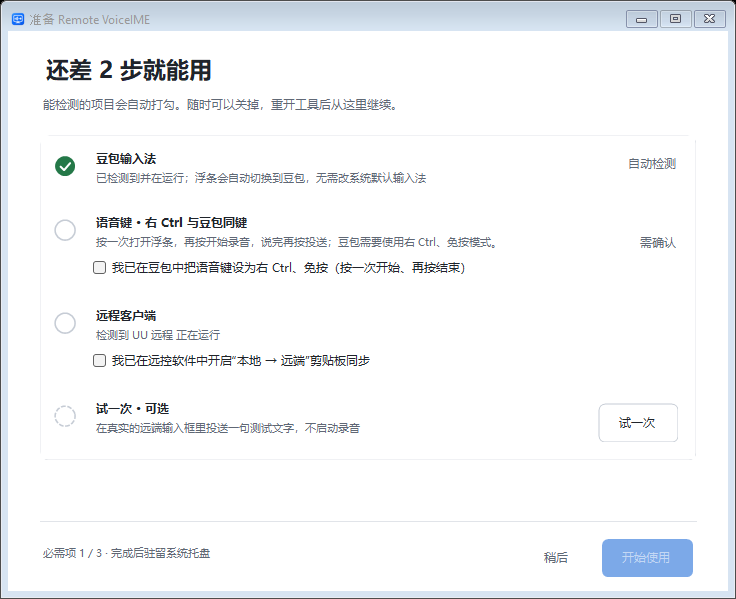
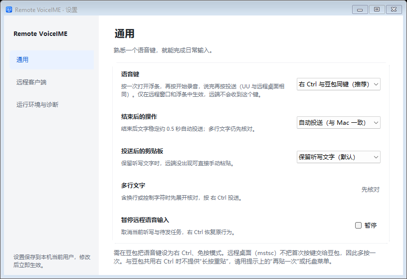
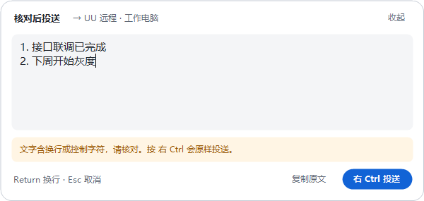

# Windows 使用指南 · 0.3.1 alpha（构建 11）

适用场景：**Windows 本地豆包语音 → Windows 上的 UU 远程或远程桌面（mstsc）→ 远端文本编辑器**。这是 Windows 原生实现，不是在 Windows 上运行 macOS 的 `.app`。实现原理见[架构说明](架构说明.md#windows)。

> [下载 Windows 0.3.1](https://github.com/jacksonlin-infra/remote-voiceime/releases/tag/v0.3.1-windows)。安装在你操作键盘和麦克风的本地 Windows；远端无需安装本工具。

## 快速记住

右 Ctrl 打开浮条 → 右 Ctrl 开始录音 → 说话 → 右 Ctrl 结束并投送。**UU 与 mstsc 均为三次按键**；先按下文把新安装默认 F8 改为右 Ctrl 同键并启用自动投送。

## 安装

推荐下载 `RemoteVoiceIME-0.3.1-win-x64-setup.exe` 并运行（可直接覆盖安装 0.3.0）：

- 只为当前用户安装到 `%LOCALAPPDATA%\Programs\Remote VoiceIME`，**不需要管理员权限**，不安装服务、不开机自启。
- 创建开始菜单快捷方式，桌面快捷方式可选；可在系统“已安装的应用”中卸载。卸载保留 `%LOCALAPPDATA%\RemoteVoiceInput` 中的设置。
- 安装包内置 .NET 运行时，目标为 Windows 10 / 11 x64；**没有发布者代码签名**，SmartScreen 可能提示“未知发布者”，选择“更多信息 → 仍要运行”。
- 旧版本正在托盘运行时，安装程序会提示先从托盘退出。

也可以下载免安装的 `RemoteVoiceIME-0.3.1-win-x64.zip`，解压后运行 `Remote VoiceIME.exe`。解压覆盖不会更新已运行的进程，先从托盘退出旧版。

安装后在「设置 → 运行环境与诊断」底部核对 `0.3.1（构建 11）`。从 0.2.0 升级时设置自动沿用：工具快捷键、按设备记住的粘贴键、自动投送不变，原“兼容 / 快速”同步速度对应新的“兼容 / 快速”。

## 准备清单

首次运行显示一页准备清单，能检测的项目自动打勾，其余由你勾选确认；必需项就绪后启动不再弹出，随时可从「设置 → 运行环境与诊断 → 打开准备清单」重开。

| 项目 | 如何判断 |
| --- | --- |
| 豆包输入法（必需） | 自动检测安装与运行 |
| 语音键（必需） | 与豆包同键时需确认豆包已设为右 Ctrl、免按；F8 模式无需改豆包，可一键改用右 Ctrl 同键（同时开启自动投送） |
| 远程客户端（必需） | 显示是否检测到 UU / 远程桌面在运行；需勾选已开启“本地 → 远端”剪贴板同步 |
| 试一次（可选） | 在真实远端输入框投送一句测试文字 |



## 推荐配置：与豆包同键（右 Ctrl）

1. **豆包**：语音快捷键改为 **右 Ctrl**，使用免按模式（按一次开始、再按结束）。
2. **本工具「设置 → 通用」**：语音键选「右 Ctrl 与豆包同键（推荐）」，结束后的操作选「自动投送（与 Mac 一致）」。
3. **「设置 → 远程客户端」**：UU 的粘贴按键选与你在 UU 里手动粘贴相同的键——**Mac 远端为 Win + V**（UU 把 Win 映射为 ⌘），Windows 远端为 Ctrl + V。工具按 UU 设备分别记住；名称像 Mac 的新设备（MacBook、MacMini、iMac 等）默认 Win + V，首次投送到未设置过的设备时，底部提示可一键“改用 … 重贴”并记住。远程桌面固定 Ctrl + V。



不需要把豆包设为 Windows 默认输入法：浮条打开时会自动切换为豆包（只影响本工具）。

### UU 远程与远程桌面：按三次

1. 在远端编辑框放好光标，按 **右 Ctrl**：本地出现胶囊浮条。这次按键不交给豆包，也不发给远端。
2. 再按 **右 Ctrl**：豆包开始录音，说话；识别文字实时显示在浮条里，长句向上增高，最多 8 行，始终显示最新文字。
3. 说完按 **右 Ctrl**：豆包结束录音；文字稳定约 0.5 秒后自动切回远端并粘贴，屏幕底部提示“已投送 N 字”。

第一次按键只打开浮条，是因为豆包只在自己是当前输入法的窗口里响应语音键：在 UU 窗口里交给豆包时常被拒绝（豆包提示“当前不是豆包输入法”，后续按键也会失灵），同时 Ctrl 会发到远端；远程桌面则根本不把这次按键交给豆包。豆包约 1 秒没响应时，浮条提示再按一次，并重新选中豆包。


## 每次按键都有回应

不抢焦点的底部提示说明结果和下一步，点提示上的按钮时远控窗口仍在前台：

- **已投送 N 字 · 再贴一次**：远端没出现时点“再贴一次”重贴同一段文字。
- **上一条正在投送**：上一条还在粘贴时按了语音键，粘贴完成后自动打开浮条，再按一次开始录音。
- **没有识别到文字**：按了没说话，约 2.5 秒后结束本轮并交还焦点。
- **没有找到远程窗口**：先点一下远端输入框再按。
- **本次未投送**：写明原因（窗口没回到前台、修饰键未松开、剪贴板被改写等），可“重新投送”或“打开核对”。

## 核对后投送

文字含换行、控制字符或超过 64 KiB 时展开为核对卡片：Return 换行、Esc 取消、可复制原文，按 **右 Ctrl 投送**；没有鼠标发送按钮，也不需要再勾选确认。被拒绝时屏幕提示原因，诊断记录固定代码（如 `refused=sourceNotStopped`）。



## 剪贴板与同步速度

- **投送后的剪贴板**（设置 → 通用）：默认保留听写文字——远端同步慢、没贴出来时，直接在远端手动粘贴即可补救；可改为“恢复原内容”（恢复前确认仍是本次写入，不会覆盖你后来复制的内容）。
- **同步速度**（设置 → 远程客户端）：快速 180 毫秒 / 标准 0.5 秒 / 兼容 1.2 秒；远程桌面固定 0.3 秒。久未使用（超过 2 分钟）后的第一条至少等 0.8 秒。远端贴出旧内容时改用兼容速度。
- 投送前会等远控窗口回到前台并稳定、修饰键松开，最多比同步时间多等 1.5 秒；远控把远端剪贴板回写本机且你没有键鼠操作时，自动重新写入一次。

## 试一次

在准备清单或「设置 → 远程客户端」点“试一次”，提示“切到远端输入框，按 右 Ctrl”。在远端输入框按语音键，工具投送一句固定测试文字（不启动录音），再问“远端出现测试文字了吗？”。选“没有 / 不完整”时按现象一键调整后立即重测：贴出旧内容 → 兼容速度；出现 v 或什么都没有 → 切换这台 UU 设备的粘贴键；手动粘贴也不行 → 查看开启剪贴板同步的方法。结果按 UU 设备（或远程桌面）与“粘贴键 + 速度”保存，配置改变后显示未测试。


## 取消、最近文字与托盘

- 听写中点 × 或按 Esc：只取消本轮。豆包仍在录音时浮条保留到录音结束后自动关闭，避免后续文字进入其他窗口；之前排队的文字随后继续投送。取消后立即在原远端按右 Ctrl，豆包仍在录音则直接接入新一轮。
- 托盘菜单：状态、最近文字（每条可复制原文 / 再投送到原窗口 / 打开核对）、全部最近文字、有排队时“取消等待中的投送”、暂停、设置、退出。托盘图标区分就绪 / 听写中 / 投送中 / 需处理 / 已暂停。
- 最近文字只在内存保留 5 条 / 5 分钟，退出即清空。
- 与豆包共用右 Ctrl 时不提供“长按重贴”（长按也会切换豆包录音），请用提示或托盘菜单的再投送。

先确认远端没有收到，再使用“再贴一次”或最近文字重投，避免重复输入。应用驻留系统托盘，若看不到图标，展开任务栏的隐藏图标区。

## 排查

- 确认 UU 本身能把本地复制的文字粘贴到远端（Mac 远端用 Win + V）。
- **Deskflow / Synergy 等剪贴板共享**会改写本机剪贴板，失败提示会写出进程名；遇到时关闭其剪贴板共享。
- 剪贴板含图像 / 元文件等句柄格式时拒绝覆盖，请先复制一小段纯文本；备份上限 16 MB。
- 工具与远控软件使用相同运行级别；本版不自动提权。
- 「设置 → 运行环境与诊断 → 复制诊断」或 `%LOCALAPPDATA%\RemoteVoiceInput\diagnostics.log`：只含阶段、检查结果（如 `blocked=focus`）、按键扫描码与耗时，不含正文、剪贴板内容或窗口标题。日志每次启动覆盖，出问题后请在重启工具前复制。

## 本地数据与构建

设置保存在 `%LOCALAPPDATA%\RemoteVoiceInput\settings.json`。正文只在内存中；不调用识别 API、不采集音频、不联网。投送写入的剪贴板带禁入 Windows 剪贴板历史 / 云剪贴板标记。

源码在 `windows/Bridge.Core`（可移植状态逻辑）与 `windows/Bridge.Windows`（原生适配）。构建需 .NET 10 SDK，安装程序需 NSIS 3：

```powershell
./scripts/build-windows.ps1
# 生成 ZIP、安装程序和 SHA-256 清单（默认先重新构建）
./scripts/package-windows.ps1
```

SDK 不在 PATH 时设置 `$env:DOTNET_BIN`，NSIS 不在默认位置时设置 `$env:NSIS_BIN`。输出 `dist/RemoteVoiceIME-0.3.1-win-x64.zip`、`dist/RemoteVoiceIME-0.3.1-win-x64-setup.exe` 与 `dist/SHA256SUMS.windows-win-x64.txt`。

### Windows 实机自检

```powershell
& ".\Remote VoiceIME.exe" --preview-ui .\ui-preview light   # 或 dark；省略则跟随系统
& ".\Remote VoiceIME.exe" --verify-clipboard .\clipboard-check
& ".\Remote VoiceIME.exe" --verify-ime .\ime-check          # 浮条切换到豆包输入法的自检
```

`--preview-ui` 渲染浮条、底部提示、准备清单、三页设置、最近文字与托盘图标（含 125% / 150% 模拟缩放），并检查核对无鼠标发送且无勾选、组字时占位隐藏、长文与组字增高、文字不越界、提示上的再贴一次、准备清单开始门槛；不创建钩子、语音来源或远端连接。`--verify-clipboard` 对真实剪贴板做三轮备份 / 写入 / 同步等待 / 恢复。两者都不能代替豆包 / UU 实测。
