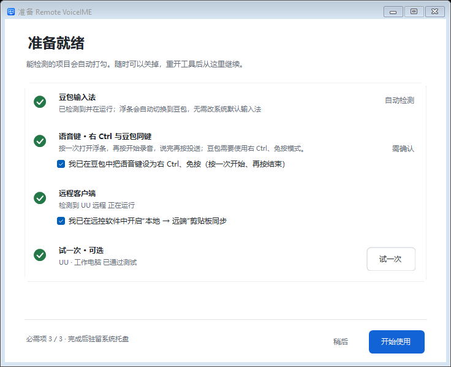
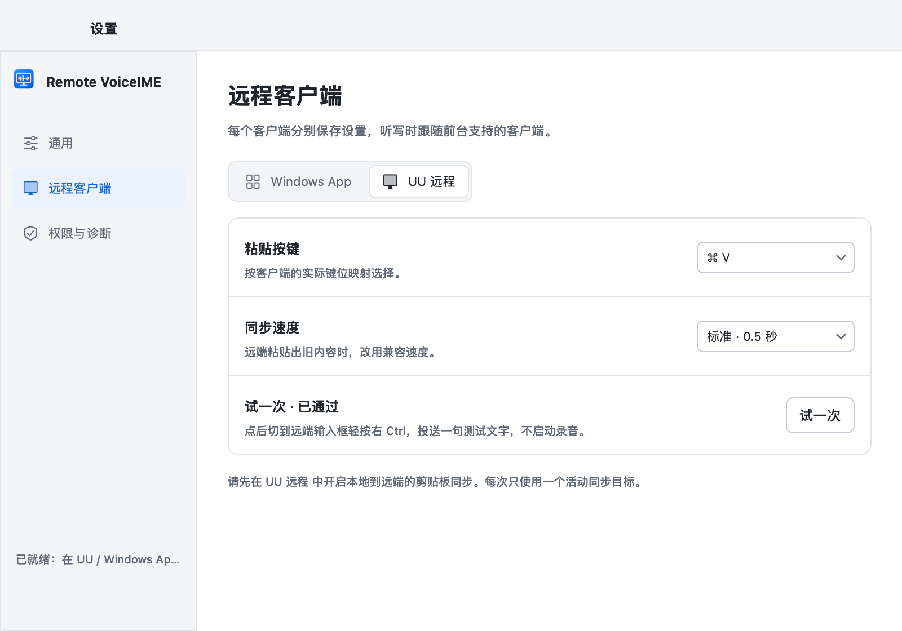
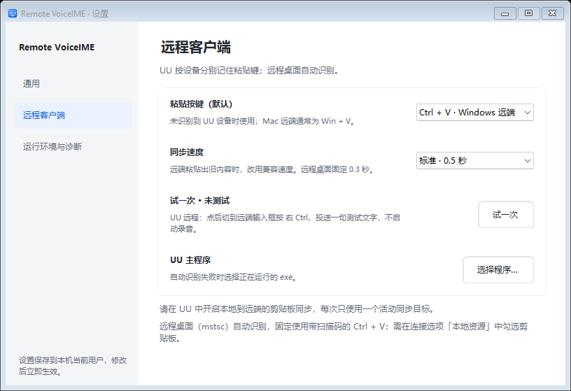
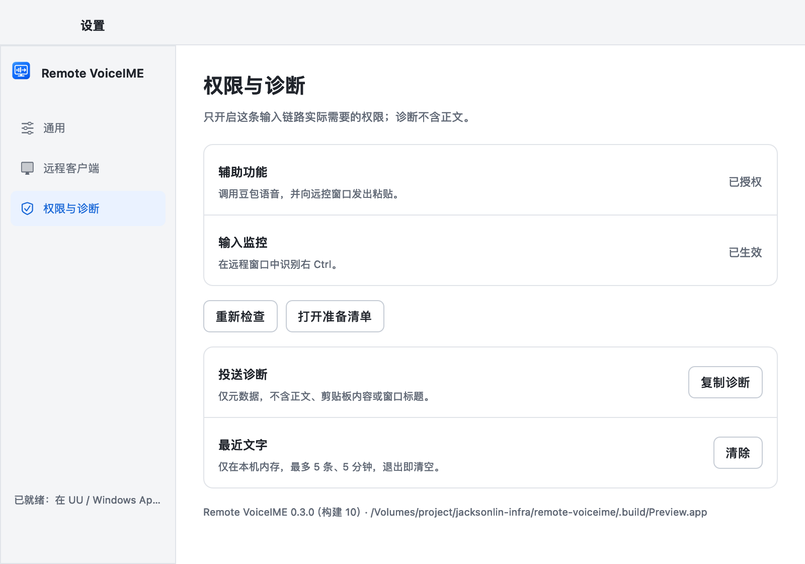
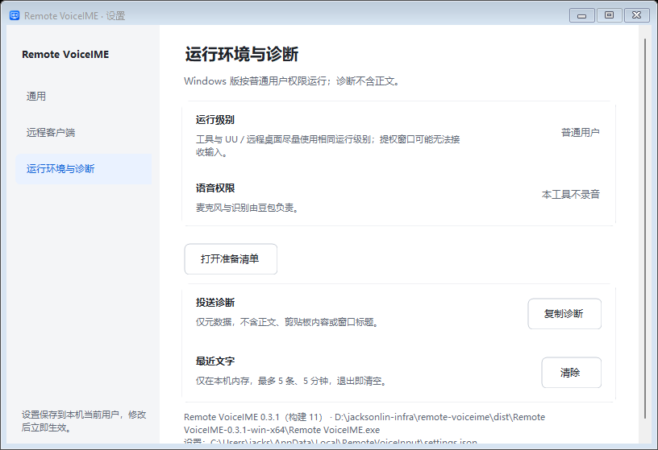
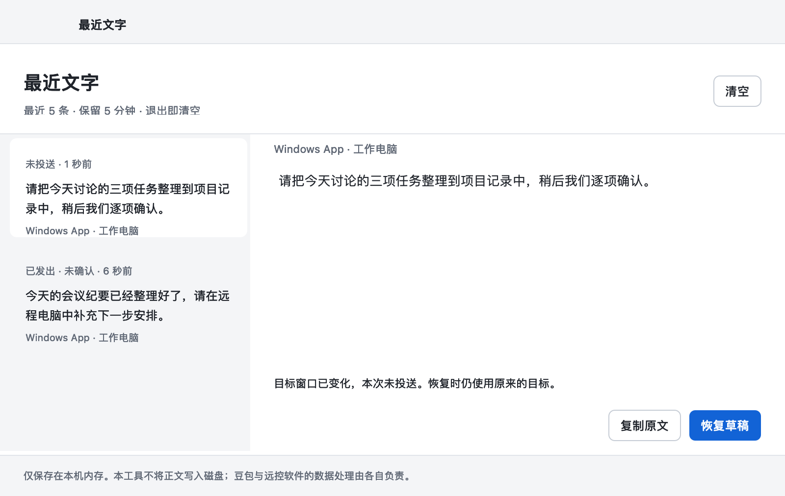
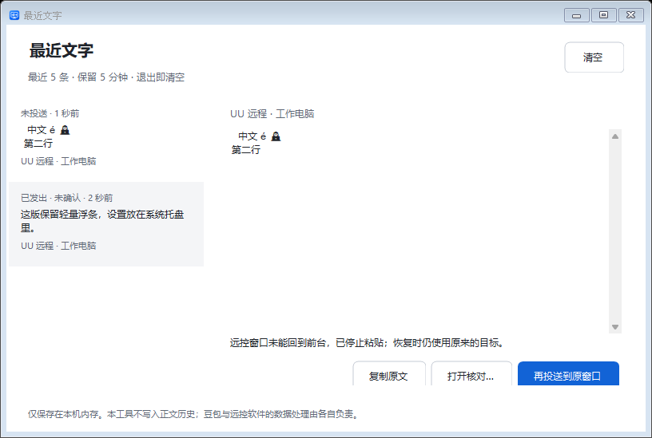
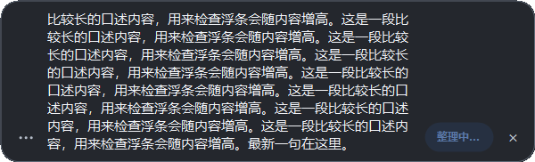
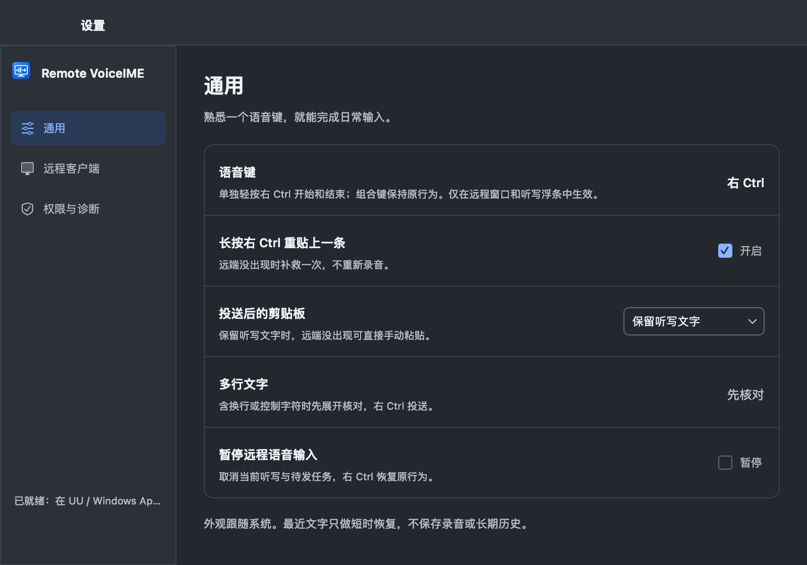
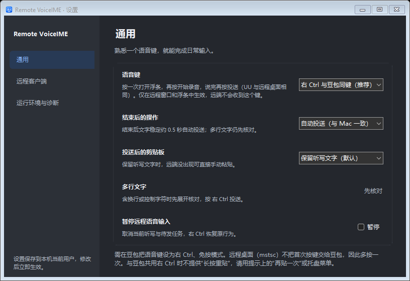

# 当前应用界面与截图来源

本页供用户查看当前界面，也记录截图生成方式。图片中的听写、设备名和测试文字均为示例，不是远端成功接收的证明。返回[快速上手](../../README.md#第一次使用)。

## 版本与来源

| 平台 | 对应发行版 | 来源 |
| --- | --- | --- |
| macOS | 0.3.0（构建 10） | 2026-10-28 从 `b8424e1` 的 AppKit 组件重新离屏渲染；`src/`、`tests/Preview.swift` 与 `v0.3.0-macos` 相同，预览版本信息取该发行标签 |
| Windows | 0.3.1（构建 11） | 随最新代码同步的 Windows 原生 `--preview-ui` 结果；浅 / 深色各 90 项检查，记录见 [light/verification.txt](windows-verification/light/verification.txt) / [dark/verification.txt](windows-verification/dark/verification.txt)；本轮在 Mac 上查看，未重新运行 Windows GUI |

截图是原生控件渲染，未使用 HTML 设计稿替代应用界面。Windows 的 `@125` / `@150` 是模拟缩放预览，不代表真实高 DPI 或多显示器验收。准备清单和设置中的勾选、按键、客户端是演示配置，首次运行请以应用检测到的状态为准。

## 准备就绪

| macOS | Windows |
| --- | --- |
|  |  |

Windows 初始 F8 模式：[准备清单](windows-verification/light/setup-f8.png)；推荐改用右 Ctrl，再按清单确认豆包语音键。

## 远程客户端设置

粘贴按键必须与你在远端手动粘贴能成功的按键一致；同步慢时改为兼容速度，并用“试一次”确认。

| macOS | Windows |
| --- | --- |
|  |  |

## 权限与诊断

| macOS：权限与诊断 | Windows：运行环境与诊断 |
| --- | --- |
|  |  |

## 长文与最近文字

| macOS 长文浮条 | Windows 长文浮条 |
| --- | --- |
|  |  |

| macOS 最近文字 | Windows 最近文字 |
| --- | --- |
|  |  |

最近文字保留 5 条、5 分钟，退出清空；再次投送前请先确认远端没有收到。

## 深色界面

| macOS | Windows |
| --- | --- |
|  |  |
|  |  |

## 重新生成（维护者）

Mac 执行 `./scripts/preview.sh`，生成当前 AppKit 图片并检查布局及交互，不录音、不监听键盘、不访问通用剪贴板、不向远端发送文字。默认版本读取共享 `resources/Product.props`。两端独立发布时，文档截图应与其平台的实际发行版一致：本轮先确认 Mac 源码与 `v0.3.0-macos` 相同，再仅将 `.build/Preview.app/Contents/Info.plist` 中的 `CFBundleShortVersionString` / `CFBundleVersion` 设为 `0.3.0` / `10`，重新执行：

```bash
".build/Preview.app/Contents/MacOS/Preview" "$PWD/docs/assets"
```

这只调整预览 bundle 的显示信息，不修改共享产品版本或正式应用。若原生源码已变化，应标注为开发预览或从相应发行标签生成，不能只换版本文字冒充旧版截图。

Windows 在对应版本的 Windows 环境执行：

```powershell
& ".\Remote VoiceIME.exe" --preview-ui .\ui-preview-light light
& ".\Remote VoiceIME.exe" --preview-ui .\ui-preview-dark dark
```

查看两套 `verification.txt` 及 PNG，核对版本和画面，再同步到 `windows-verification/light`、`windows-verification/dark`。本目录只保留当前界面截图。
