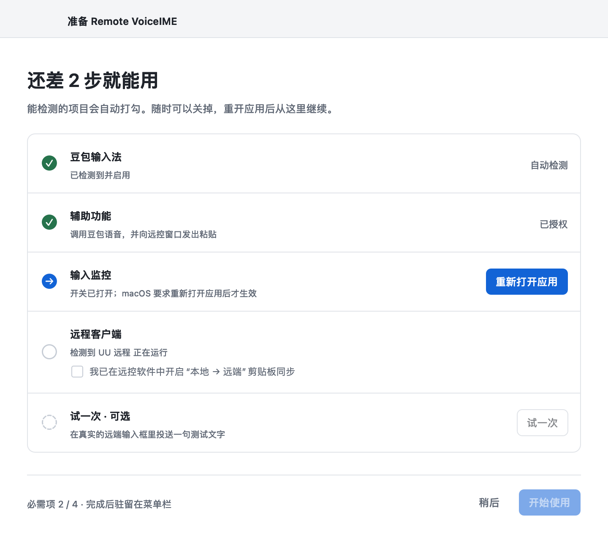

# macOS 使用与排查 · 0.3.0（构建 10）

Remote VoiceIME 在本机接收豆包听写，通过 UU / Windows App 的剪贴板同步向远端投送。应用装在本地 Mac，远端无需安装本工具。工具键为**单独轻按右 Ctrl**；长按约 0.6 秒为“重贴上一条”。

> 下载：[macOS 0.3.0 Release](https://github.com/jacksonlin-infra/remote-voiceime/releases/tag/v0.3.0-macos)。0.2.1 使用四步引导和旧浮条，其说明见 `v0.2.1-macos` 标签中的本文件。

## 快速记住

- 安装在本地 Mac，远端无需装本工具；先让本地豆包听写和远控剪贴板同步可用。
- 右 Ctrl 开始 → 说话 → 右 Ctrl 结束并投送，Mac 不需要修改豆包自身快捷键。
- 没收到时先看一眼远端，再用“再贴一次”；菜单栏图标可打开设置和最近文字。

## 安装与升级

1. 先从菜单栏退出旧版，将 `Remote VoiceIME.app` 放入 `/Applications` 等固定位置，再打开这一份应用。
2. 在“设置 → 权限与诊断”底部核对版本 **0.3.0（构建 10）**。覆盖文件不会更新已运行的进程，不要同时打开多个副本。
3. 按准备清单完成必需项；“试一次”可选。

如果首次打开提示无法验证开发者，确认下载自上方项目 Release 后，到“系统设置 → 隐私与安全性”，找到此应用对应的“仍要打开”，按系统提示确认。步骤见 [Apple 官方说明](https://support.apple.com/zh-cn/102445)。

应用准备完成后驻留菜单栏，关掉准备清单不会退出。点击菜单栏图标可打开设置、最近文字或退出。

最低部署目标为 macOS 13，当前只验证 Apple Silicon。版本仍为 alpha，使用本地 ad-hoc 签名，未完成 Developer ID 签名或公证。

## 准备清单

首次打开，或有必需项失效时，显示一页准备清单：

| 项目 | 如何判断 | 未就绪时 |
| --- | --- | --- |
| 豆包输入法 | 自动检测已启用的豆包输入源 | “打开键盘设置”，在输入法中添加豆包 |
| 辅助功能 | 自动检测 | “授权”：先向系统发起请求，应用会出现在系统列表里，只需打开开关 |
| 输入监控 | 自动检测，并确认键盘监听确实在运行 | “授权”；开关打开后 macOS 要求重开，点“重新打开应用” |
| 远程客户端 | 显示正在运行的 UU / Windows App；剪贴板同步需你勾选确认 | 在远控软件中开启“本地 → 远端”剪贴板同步 |
| 试一次（可选） | 显示已通过测试的客户端 | 见下一节 |

进度不需要“保存”：每一项都按当前实际状态计算。无论是点清单里的“重新打开应用”，还是系统弹出的“退出并重新打开”，重开后都直接回到清单，已完成的项目不再询问。必需项全部就绪后点“开始使用”（或直接关掉窗口），之后启动不再弹出。设置的“权限与诊断”页可随时重新打开清单。

工具不申请麦克风、屏幕录制或完全磁盘访问。麦克风权限由豆包管理。

**升级后按键没有反应：** 临时签名会随二进制改变，系统开关已开启也可能仍关联旧版。清单会把失效的一项标出来；若开关看着已开但仍未生效，在系统设置中移除本工具旧条目，重新添加实际使用的 `/Applications/Remote VoiceIME.app` 并启用，然后“重新打开应用”。Bundle ID 为历史兼容值 `local.jackson.UURightOptionVoice`；旧条目可能显示“UU右Alt豆包语音”。

## 试一次

1. 在 UU 或 Windows App 开启本地到远端剪贴板同步；Windows App 的连接设置位于 Devices & Audio / 设备与音频。
2. 在清单或“设置 → 远程客户端”点“试一次”。屏幕底部出现“测试 · 切到远端输入框，轻按右 Ctrl”。
3. 在可丢弃的远端普通编辑器中放好光标，轻按右 Ctrl。工具投送一句固定测试文字，不启动录音。
4. 回答“远端出现测试文字了吗？”。选“出现了”即记为通过。
5. 选“没有 / 不完整”时，按看到的现象一键调整后立即再测：
   - 贴出了别的旧内容 → 改用兼容速度；
   - 出现一个 v 或什么都没有 → 切换 ⌘V / Ctrl＋V；
   - 手动复制粘贴也不行 → 远控软件的剪贴板同步没有打开。

结果按客户端分别保存，只对测试时的粘贴键和同步速度有效；改了任一项，该客户端回到“未测试”。工具无法读取远端回执，通过与否由你确认。

## 听写与连续输入

在远端放好光标 → **右 Ctrl 开始** → 说话 → **右 Ctrl 结束** → 等待定稿和自动投送。听写时浮条是一行胶囊，内容变长时向上展开、最多显示 8 行最新文字（更早的内容可滚动查看）；结束后屏幕底部提示“已投送 N 字”。

- 右 Ctrl 组合键及 Ctrl＋点击保留原操作，单独轻按才触发。其他本地应用中的右 Ctrl 保持原行为。
- 上一条还在粘贴时按右 Ctrl，提示“上一条正在投送”，粘贴完成后自动开始这一轮。
- 按了没说话、豆包也没返回文字时，2.5 秒后提示“没有识别到文字”并把焦点交还远端。
- 含换行、制表符或其他控制字符时展开核对：Return 换行，右 Ctrl 投送，Esc 取消。核对不需要勾选确认。
- 后续投送按顺序排队，最多三条待发；正在听写时不会抢焦点执行下一条。

含换行的核对卡片：

## 远端没出现时

先确认远端确实没有收到，避免重复粘贴。

1. **点提示上的“再贴一次”**，或在远端输入框**长按右 Ctrl**：重贴最近一条已投送 / 未投送的文字到原窗口。长按可在“设置 → 通用”关闭。
2. **直接在远端粘贴**：默认投送后听写文字留在剪贴板，同步慢时远端手动粘贴即可。
3. **从菜单“最近文字”**：每条都有“复制原文 / 再投送到原窗口 / 打开核对…”。

若远端反复贴出同一段旧内容，说明远控的剪贴板同步慢于粘贴：在“设置 → 远程客户端”把同步速度改为兼容（1.2 秒），再试一次。

## 设置

| 页面 | 项目 | 当前行为 |
| --- | --- | --- |
| 通用 | 语音键 | 固定为右 Ctrl |
| | 长按右 Ctrl 重贴上一条 | 默认开启 |
| | 投送后的剪贴板 | 默认“保留听写文字”；可改为“恢复原内容”（只在剪贴板仍是本次写入时恢复，不覆盖你后来复制的内容） |
| | 暂停 | 取消当前捕获与待发任务，右 Ctrl 恢复原行为 |
| 远程客户端 | 粘贴按键 | ⌘V 或 Ctrl＋V，与你在该连接中手动粘贴一致 |
| | 同步速度 | 快速 180 ms / 标准 0.5 秒 / 兼容 1.2 秒；UU 默认标准，Windows App 默认兼容；旧版保存的“快速”按标准处理 |
| | 试一次 | 显示该客户端的测试结果 |
| 权限与诊断 | 权限 | 授权、重新检查、重新打开应用、打开准备清单 |
| | 投送诊断 | 复制元数据，不含正文、剪贴板内容或窗口标题 |
| | 最近文字 | 内存中最近 5 条、5 分钟，退出清空；可手动清除 |

Mac 版按**客户端**保存设置，尚未按 UU 设备分别保存。

## 投送时的等待与保护

- 写入剪贴板后至少等待所选同步时间；久未使用（2 分钟以上）后的第一条至少等 0.8 秒。
- 远控窗口回到前台并稳定 0.1 秒、修饰键松开后才发粘贴键；最多再多等 1.5 秒，仍不满足就停止并保留文字。
- 等待期间若远控把远端剪贴板回写到本机、且你没有任何键鼠操作，工具重新写入一次并重新等待；你自己复制的新内容不会被覆盖。
- 取消本轮（Esc / 关闭浮条）只取消本轮；之前排队的文字在确认豆包录音已结束后继续投送，8 秒仍无法确认时停止并保留到最近文字。

## 收集诊断

再次出现“没投到远端”时：

1. 记下底部提示是“本次未投送”及原因，还是“已投送”但远端没有。
2. 结束当前听写和投送后，在“设置 → 权限与诊断”点“复制诊断”。记录只在内存中，重启会清空。
3. 诊断会标明停在哪一道检查：`blockedByFocus`（窗口没回前台）、`blockedByWindow`（窗口变了）、`blockedByModifiers`（按键没松开）、`blockedByClipboard`（剪贴板被改写），以及 `clipboardReclaimed`（远控回写后重新写入）。`pasteAttempted` 只表示已发出按键。

## 其他排查

| 现象 | 处理 |
| --- | --- |
| 右 Ctrl 无反应 | 菜单栏图标为橙色时先看准备清单；确认未暂停、受支持远控在前台、物理键为右 Control |
| 提示“没有找到远程窗口” | 先点一下远端输入框，再按右 Ctrl |
| 豆包启动失败 | 工具已自动重试一次；浮条提示后可按右 Ctrl 再试。检查输入法菜单的语音输入入口和麦克风 |
| 等待定稿超时 | 30 秒仍未定稿时转为核对，正文保留 |
| 原窗口关闭 / 改变 | 复制原文手动转移，不自动绑定到另一个目标 |
| 剪贴板备份失败 | 类型不可读或总数据超过 16 MB；先自行保存重要内容 |
| 正文超过 64 KiB | 保留完整草稿，展开分段或复制 |

## 数据与验证范围

工具本身不录音、不联网、不落盘保存正文。识别文字会暂时存在浮条内存和剪贴板；默认投送后留在剪贴板。豆包与远控客户端有各自的数据处理方式。

macOS 与 Windows App、UU 的日常流程已经实际验证，基本功能稳定，包括听写、再投送和核对后投送。全屏、多屏、Deskflow 等仍需专项回归。完整范围见[支持范围与已知限制](支持范围与已知限制.md)。
